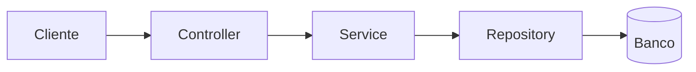

# sistema-academia
Backlog de requisitos do Sistema de Gerenciamento de Academia - Engenharia de Software.

## Arquitetura

O projeto usa arquitetura em camadas:

- controller/: recebe as requisições e devolve as respostas
- service/: regras de negócio (ex: CPF do aluno não pode repetir)
- repository/: acesso ao banco de dados
- model/: entidades
- dto/: objetos de entrada e saída da API
- mapper/: conversão entre DTO e entidade
- exception/: erros de negócio e tratamento

Exemplo: POST /alunos
1. Controller recebe o AlunoDTO e valida os campos
2. Service verifica se o CPF já existe
3. Repository salva o aluno
4. Controller devolve 201 com o aluno cadastrado